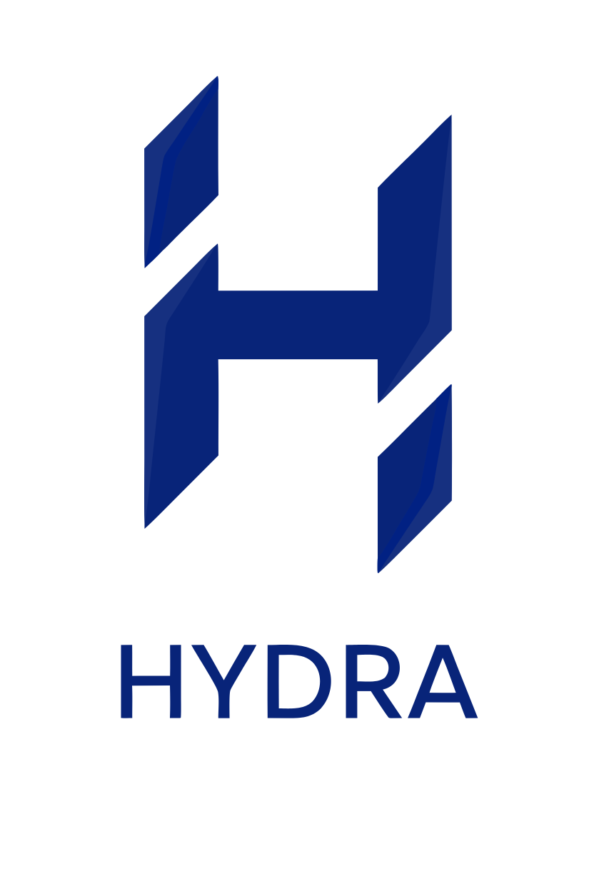
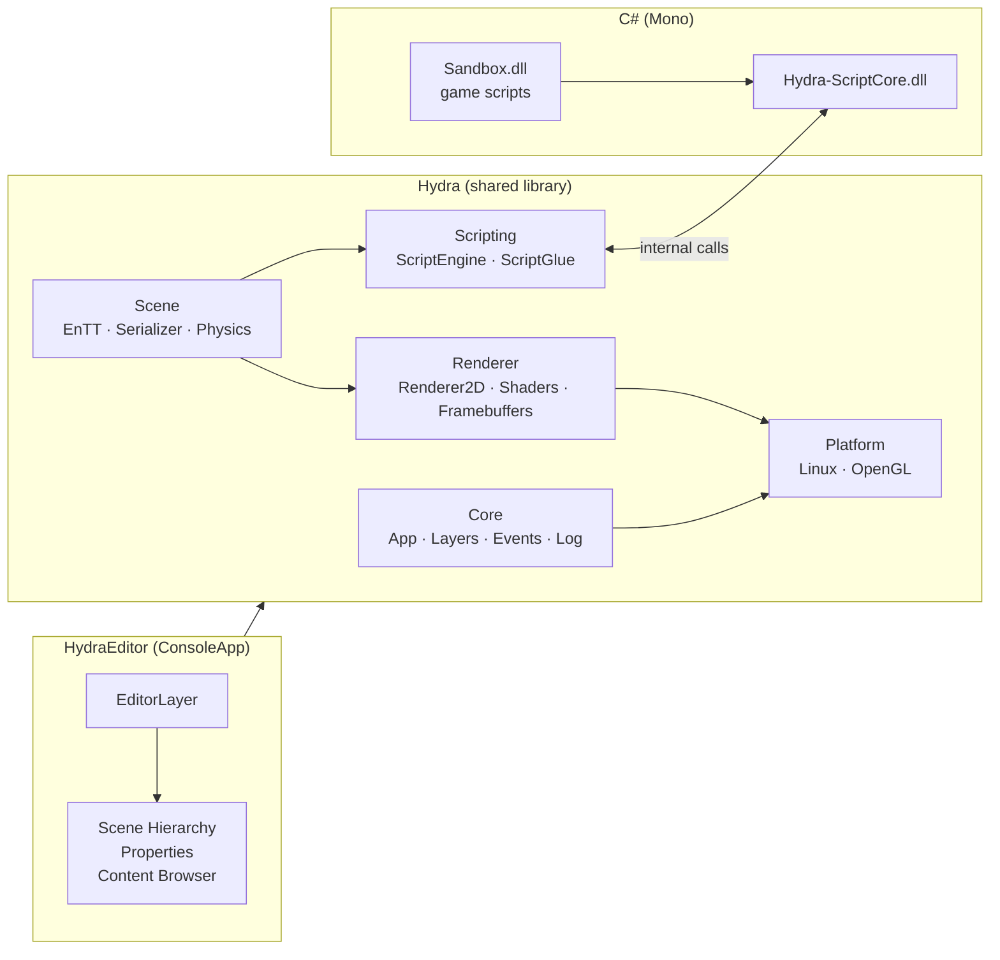

<div align="center">



# Hydra Engine

**A 2D game engine and editor written in C++17, with C# scripting and Box2D physics**


</div>

---

Hydra is a personal game engine project. It has a layered engine core, a
batched OpenGL 2D renderer, an entity-component-system scene model, Box2D
physics, an embedded Mono runtime for C# gameplay scripts, and **Hydra Editor**,
an ImGui-based editor for building, saving and play-testing scenes.

Development happened on **Linux**, which is the primary and tested platform.
The project is **finished** and no longer actively developed. The code is
kept here as a complete snapshot of the engine (see [Project status](#-project-status)).

## Table of contents

- [Features](#-features)
- [Architecture](#-architecture)
- [Scripting in C#](#-scripting-in-c)
- [Getting started](#-getting-started)
- [Using the editor](#-using-the-editor)
- [Scene file format](#-scene-file-format)
- [Third-party libraries](#-third-party-libraries)
- [Project status](#-project-status)
- [Acknowledgements](#-acknowledgements)
- [License](#-license)

## ✨ Features

### Engine core
- Application/layer architecture with a layer stack and overlays
- Event system (window, keyboard, mouse) with a typed dispatcher
- Platform abstraction for windowing and input (GLFW), with a Linux implementation
- Logging through `spdlog`, with separate core and client loggers
- Assertions, 64-bit `UUID`s, frame timestep, and command-line argument parsing
- Built-in instrumentation that writes Chrome Tracing (`chrome://tracing`) profiles

### Renderer
- Renderer API abstraction with an **OpenGL 4.5** backend (Direct State Access)
- **Batched 2D renderer**: quads, textured and tinted sprites, circles (with thickness and fade), lines and rectangles
- Up to 32 texture slots per batch, plus render statistics (draw calls, quads, circles, vertices)
- GLSL shaders compiled to **SPIR-V** with `shaderc`, reflected with `SPIRV-Cross`, and cached on disk in `assets/cache/shaders`
- Uniform buffers, framebuffers with several color attachments, and an integer **entity-ID attachment** for mouse picking
- Orthographic, scene (perspective/orthographic) and editor cameras

### Scene and ECS
- Scenes built on [EnTT](https://github.com/skypjack/entt), with a thin `Entity` handle
- Components: `ID`, `Tag`, `Transform`, `SpriteRenderer`, `CircleRenderer`, `Camera`, `Script`, `NativeScript`, `Rigidbody2D`, `BoxCollider2D`, `CircleCollider2D`
- Scene serialization to human-readable YAML (`.hydra` files), including C# script field values
- Deep scene copy, so play mode runs on a throwaway copy and the edited scene is left untouched

### Physics
- 2D rigid-body physics with **Box2D v3**: static, dynamic and kinematic bodies
- Box and circle colliders with density, friction and restitution
- Fixed-rotation bodies and continuous collision (bullet mode) for dynamic bodies
- A *Simulate* mode that runs physics without scripts, viewed through the editor camera

### C# scripting
- Embedded **Mono** runtime that loads a core API assembly (`Hydra-ScriptCore.dll`) and a game assembly (`Sandbox.dll`)
- Entity classes deriving from `Hydra.Entity`, with `OnCreate()` and `OnUpdate(float ts)`
- Public script fields are found through reflection, shown in the editor, and saved with the scene. Supported types: all numeric types, `bool`, `char`, `Vector2/3/4`
- Native ↔ managed bridge (`ScriptGlue`) for transforms, sprite and circle colors, rigid-body impulses, input and logging
- Managed exceptions are caught and logged with their full `InnerException` chain instead of crashing the editor

### Hydra Editor
- Dockable ImGui workspace: **Viewport**, **Scene Hierarchy**, **Properties**, **Content Browser**, **Stats** and **Settings** panels
- **Play / Simulate / Stop** toolbar
- Translate, rotate and scale gizmos (ImGuizmo), with snapping
- Click-to-select entities in the viewport (pixel-perfect, using the entity-ID buffer)
- Drag and drop scenes from the content browser into the viewport, and textures onto sprites
- Optional display of physics colliders
- Native open/save file dialogs (Zenity) and keyboard shortcuts for common actions

## 🏗 Architecture



### Repository layout

```
Hydra/
├── Hydra/                      # Engine (built as a shared library)
│   ├── src/Hydra/
│   │   ├── Core/               # Application, layers, window, input, logging, UUID
│   │   ├── Events/             # Event types and dispatcher
│   │   ├── Renderer/           # Renderer API, Renderer2D, cameras, buffers, shaders
│   │   ├── Scene/              # Scene, Entity, components, serializer
│   │   ├── Scripting/          # Mono ScriptEngine and the C++ <-> C# glue
│   │   ├── ImGui/              # ImGui layer
│   │   └── Math/               # Transform decomposition helpers
│   ├── src/Platform/           # Linux, Windows and OpenGL implementations
│   └── vendor/                 # Third-party libraries (git submodules + vendored)
├── Hydra-ScriptCore/           # C# engine API used by game scripts
├── HydraEditor/                # Editor application
│   ├── src/                    # EditorLayer and panels
│   ├── assets/                 # Scenes, shaders, textures, fonts
│   ├── Resources/              # Editor icons and the built Hydra-ScriptCore.dll
│   └── SandboxProject/         # Example game project with C# scripts
├── Sandbox/                    # Minimal 2D renderer test application
├── scripts/                    # Python/Bash setup and build scripts
├── vendor/premake/             # Premake build configuration
├── premake5.lua                # Workspace definition
└── Dependencies.lua            # Include/library paths for dependencies
```

## 🧩 Scripting in C#

Game logic lives in a separate C# project
(`HydraEditor/SandboxProject/Assets/Scripts`). A script is a class that
derives from `Hydra.Entity`. Its public fields appear in the editor's
Properties panel, where they can be tweaked and saved with the scene:

```csharp
using Hydra;

namespace Sandbox
{
    public class Player : Entity
    {
        private Rigidbody2DComponent m_Rigidbody;

        public float Speed;          // editable in the Properties panel
        public float Time = 0.0f;

        void OnCreate()
        {
            m_Rigidbody = GetComponent<Rigidbody2DComponent>();
        }

        void OnUpdate(float ts)
        {
            Time += ts;

            Vector3 velocity = Vector3.Zero;
            if (Input.IsKeyDown(KeyCode.W))      velocity.Y = 1.0f;
            else if (Input.IsKeyDown(KeyCode.S)) velocity.Y = -1.0f;
            if (Input.IsKeyDown(KeyCode.A))      velocity.X = -1.0f;
            else if (Input.IsKeyDown(KeyCode.D)) velocity.X = 1.0f;

            m_Rigidbody.ApplyLinearImpulse(velocity.XY * Speed * ts, true);
        }
    }
}
```

To use a script, add a **Script** component to an entity and enter the full
class name (for example `Sandbox.Player`). The name turns red if the class
can't be found in the loaded assembly.

**Available API:** `Entity` (`ID`, `Translation`, `HasComponent<T>()`,
`GetComponent<T>()`), `TransformComponent`, `SpriteRendererComponent`,
`CircleRendererComponent`, `Rigidbody2DComponent.ApplyLinearImpulse(...)`,
`Input.IsKeyDown(KeyCode)`, `Log.Trace/Info/Warn/Error`, and the
`Vector2`/`Vector3`/`Vector4` math types.

## 🚀 Getting started

### Prerequisites (Ubuntu / Debian)

| Requirement | Why it's needed | Install |
|---|---|---|
| GCC or Clang with C++17, `make` | Engine and editor | `sudo apt install build-essential` |
| Python 3 | Setup scripts | `sudo apt install python3` |
| X11 / OpenGL development headers | GLFW windowing | `sudo apt install libx11-dev libxrandr-dev libxinerama-dev libxcursor-dev libxi-dev libgl-dev` |
| [Vulkan SDK](https://vulkan.lunarg.com/) | `shaderc` + `SPIRV-Cross` for shader compilation | LunarG APT repository → `sudo apt install vulkan-sdk` |
| Mono (runtime, headers, `mcs`) | Embedded C# scripting | `sudo apt install mono-complete` |
| Zenity | Native open/save file dialogs | `sudo apt install zenity` |
| GPU driver with OpenGL 4.5 | Rendering | — |

### Clone

The `--recursive` flag is **required** to fetch the submodules:

```bash
git clone --recursive https://github.com/HenrikGharagyozyan/Hydra.git
cd Hydra
```

### One-step setup, build and run

```bash
python3 Setup.py
```

The setup script checks for (and offers to install) Premake, the Vulkan SDK
and Mono, updates the submodules, generates Makefiles, builds everything in
Debug and launches Hydra Editor.

### Manual build

```bash
./vendor/premake/bin/premake5 gmake2          # generate Makefiles
make config=debug CSC=mcs -j"$(nproc)"         # build engine, editor and Hydra-ScriptCore
cd HydraEditor                                 # the editor expects this working directory
../bin/Debug-linux-x86_64/HydraEditor/HydraEditor [assets/scenes/Physics2D.hydra]
```

Available configurations are `debug`, `release` and `dist`.
`scripts/Launch/Linux-GenProject.sh` runs all three steps for you.

### Rebuilding the C# game scripts

The example game assembly is a separate Premake workspace:

```bash
./HydraEditor/SandboxProject/Assets/Scripts/Linux-GenProject.sh
```

This writes `Sandbox.dll` to `SandboxProject/Assets/Scripts/Binaries/`, where
the editor loads it at startup. Pre-built copies of both assemblies are
committed, so the editor runs scripts even without a C# compiler installed.

> **Windows:** `scripts/Setup.bat` / `scripts/Launch/Win-GenProjects.bat`
> generate a Visual Studio solution, and the engine has a Windows platform
> layer, but only Linux was built and tested regularly.

## 🎮 Using the editor

| Action | Shortcut |
|---|---|
| New / Open / Save / Save As scene | `Ctrl+N` / `Ctrl+O` / `Ctrl+S` / `Ctrl+Shift+S` |
| Duplicate selected entity | `Ctrl+D` |
| No gizmo / Translate / Rotate / Scale | `Q` / `W` / `E` / `R` |
| Snap while using a gizmo (0.5 units, 45°) | hold `Ctrl` |
| Orbit / pan / zoom the editor camera | `Alt` + left / middle / right mouse, or scroll |
| Select an entity | left-click it in the viewport |
| Create or delete entities | right-click in the Scene Hierarchy |

**Play** runs a copy of the scene with physics and C# scripts, rendered
through the scene's primary camera. **Simulate** runs physics only, viewed
through the editor camera. **Stop** throws the copy away and returns to the
unchanged edited scene.

Example scenes are in `HydraEditor/assets/scenes`. `Physics2D.hydra` shows
physics together with a scripted, keyboard-controlled player.

## 📄 Scene file format

Scenes are plain YAML, which keeps them easy to read and to diff:

```yaml
Scene: Untitled
Entities:
  - Entity: 4749798637029923526
    TagComponent:
      Tag: Ball
    TransformComponent:
      Translation: [0.7, 1.66, 0]
      Rotation: [0, 0, 1.9]
      Scale: [1, 1, 1]
    ScriptComponent:
      ClassName: Sandbox.Player
      ScriptFields:
        - Name: Speed
          Type: Float
          Data: 0.5
    CircleRendererComponent:
      Color: [0.77, 0.38, 0.38, 1]
      Thickness: 1
      Fade: 0.005
    Rigidbody2DComponent:
      BodyType: Dynamic
      FixedRotation: false
    CircleCollider2DComponent:
      Offset: [0, 0]
      Radius: 0.5
      Density: 1
      Friction: 0.5
      Restitution: 0
      RestitutionThreshold: 0.5
```

## 📚 Third-party libraries

| Library | Purpose |
|---|---|
| [GLFW](https://github.com/glfw/glfw) | Windowing, input, OpenGL context |
| [Glad](https://github.com/Dav1dde/glad) | OpenGL function loader |
| [Dear ImGui](https://github.com/ocornut/imgui) (docking branch) | Editor UI |
| [ImGuizmo](https://github.com/CedricGuillemet/ImGuizmo) | Transform gizmos |
| [EnTT](https://github.com/skypjack/entt) | Entity component system |
| [Box2D v3](https://github.com/erincatto/box2d) | 2D physics |
| [yaml-cpp](https://github.com/jbeder/yaml-cpp) | Scene serialization |
| [glm](https://github.com/g-truc/glm) | Math |
| [spdlog](https://github.com/gabime/spdlog) | Logging |
| [stb_image](https://github.com/nothings/stb) | Image loading |
| [shaderc](https://github.com/google/shaderc) / [SPIRV-Cross](https://github.com/KhronosGroup/SPIRV-Cross) | GLSL → SPIR-V compilation and reflection |
| [Mono](https://www.mono-project.com/) | Embedded .NET runtime for C# scripting |
| [Premake 5](https://premake.github.io/) | Build configuration |

## 📌 Project status

Hydra is **complete** (final release: [v1.0.0](https://github.com/HenrikGharagyozyan/Hydra/releases/tag/v1.0.0)).
It reached the point I set out to build: a working 2D engine with an editor,
physics and C# scripting. It is no longer being developed.

Known limitations, which are reasonable next steps if you fork it:

- Rendering is 2D only. There is no 3D mesh or PBR pipeline.
- Only the OpenGL backend is implemented.
- Script fields of type `Entity` are listed in the editor but can't be assigned yet.
- C# assemblies can't be hot-reloaded, so changing scripts requires an editor restart.
- There is no project system. Asset paths are relative to the `HydraEditor/` working directory.
- No parent/child entity hierarchy.

## 🙏 Acknowledgements

Hydra's architecture is based on
[TheCherno's Game Engine series](https://www.youtube.com/playlist?list=PLlrATfBNZ98dC-V-N3m0Go4deliWHPFwT)
and the [Hazel](https://github.com/TheCherno/Hazel) engine, which I followed
as a learning resource. Hydra differs from it in a few ways:

- Linux-first platform layer and Python/Bash setup scripts
- Migration to the Box2D v3 C API
- Mono embedding fixes for Linux, such as preloading .NET's `libSystem.Native.so` and routing managed calls through exception-checked invocation
- Script field serialization for every supported type

## 📜 License

Hydra is licensed under the [Apache License 2.0](LICENSE).
Third-party libraries in `Hydra/vendor` keep their own licenses.
